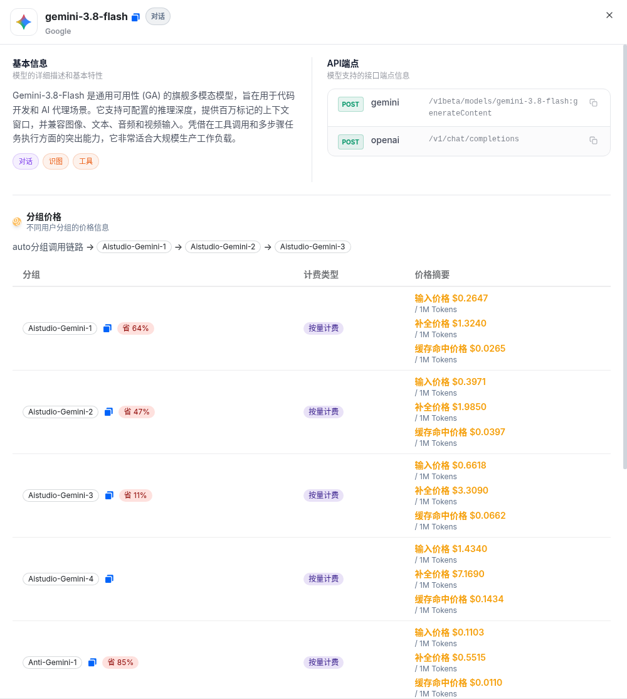

# Gemini 3.8 Flash API 调用教程：用 TryAllAPI 做 OpenAI 兼容对话接入

> **Gemini 3.8 Flash**（模型 ID：`gemini-3.8-flash`）是 Google 对话模型。本文记录如何通过聚合站 **[TryAllAPI](https://tryallapi.com/)**，从模型广场 / 价格页选型、读官方价与分组倍率，到 `POST /v1/chat/completions`（以及文档站写明的 Gemini 原生 `generateContent` 路由）的完整 **对话 API** 接入流程。价格与分组倍率取数日 **2026-10-20（北京）**，**以页面实时为准**；示例仅为请求形态说明，未跑通真实长任务计费。

**Keywords:** Gemini 3.8 Flash · gemini-3.8-flash · TryAllAPI · OpenAI 兼容 · `/v1/chat/completions` · generateContent

---

## 目录

- [为什么用聚合站调对话模型](#一为什么用聚合站调对话模型)
- [在价格页 / 模型广场找到 Gemini 3.8 Flash](#二在价格页--模型广场找到-gemini-38-flash)
- [模型怎么选：3.8 Flash 与相邻 Gemini 档](#三模型怎么选38-flash-与相邻-gemini-档)
- [价格怎么读](#四价格怎么读)
- [调用流程：Key → Base URL → chat/completions](#五调用流程key--base-url--chatcompletions)
- [curl / SDK 最小示例](#六curl--sdk-最小示例)
- [常见注意](#七常见注意)
- [FAQ](#faq)
- [小结与试用入口](#八小结与试用入口)

---

## 一、为什么用聚合站调对话模型

对话 / Agent 场景通常是 **同步 completions**：一次 `POST` 拿 `choices[].message`（或流式 chunk）。若业务同时要接 GPT、Claude、Gemini、以及视频模型，为每个厂商维护一套 Key、签名与重试逻辑会很散。

聚合站（如 [TryAllAPI](https://tryallapi.com/)）的常见价值是：

1. **统一鉴权**：一个 Bearer Key，切换 `model` 字段即可试不同档位；
2. **OpenAI 兼容形态**：Base URL 固定为 `https://tryallapi.com/v1`，多数 SDK / Cursor / Dify 可直接改地址；
3. **模型广场可对照**：标签（对话 / 工具）、分组倍率、端点类型一目了然。

下面以价格页 / 广场可见的 **`gemini-3.8-flash`** 为主线。注册试用入口：[https://tryallapi.com/register?aff=5A6A](https://tryallapi.com/register?aff=5A6A)。

---

## 二、在价格页 / 模型广场找到 Gemini 3.8 Flash

打开 [价格页](https://tryallapi.com/pricing) 或模型广场，按供应商 **Google**、类型 **对话**、关键词 `3.8` / `gemini-3.8-flash` 筛选。详情卡截图如下：



截图里详情卡要点（与广场 / 文档站一致；若截图尚未到位，请直接对照价格页）：

| 字段 | 内容 |
| --- | --- |
| **模型 ID** | `gemini-3.8-flash` |
| **供应商** | Google |
| **标签** | 对话（以广场实时标签为准） |
| **API** | OpenAI 兼容：`POST /v1/chat/completions`；文档站写明原生路由 `POST /v1beta/models/gemini-3.8-flash:generateContent` |
| **计费** | 按量（token）；分组见下节 |

同屏常见相邻卡：`gemini-3.7-flash`、`gemini-3.1-pro-preview` 等。文中 UI 品牌可能为 momoAPIPro / 模型广场，实际对接产品以 [TryAllAPI](https://tryallapi.com/) 控制台与文档为准。

更完整的参数卡亦可对照官方文档站：[Gemini 3.8 Flash API 指南](https://docs.tryallapi.com/gemini-3.8-flash-api/)。

---

## 三、模型怎么选：3.8 Flash 与相邻 Gemini 档

只根据广场 / 文档可见信息做选型对照，**不编造未出现的能力差异**：

| 模型 ID（可见） | 怎么理解（接入 / 价位视角） |
| --- | --- |
| **`gemini-3.8-flash`** | 本文主线：限时官方价输入 $0.75 / 输出 $3.75（$/1M，至 2026-12-31）；支持 thinking_level |
| **`gemini-3.7-flash`** | 同系列相邻 Flash 档；换档时只改 `model` 字符串做对照 |
| **`gemini-3.1-pro-preview`** | 同供应商 Pro 预览档；价位 / 分组通常更高，按任务再升档 |

实务上可以：默认先锁一个 `model` 字符串写进配置；遇限流或分组无货，再在同供应商的可见 ID 之间做切换，而不是改 Base URL。

---

## 四、价格怎么读

对话模型常见公式：**≈ 官方价 × 分组倍率**（以控制台为准）。取数快照：**2026-10-20 北京**；**以页面实时为准**。

### 官方价（每百万 tokens，文档站核对）

| 项目 | 限时价（至 2026-12-31） | 2027-01-01 起 |
| --- | --- | --- |
| 输入 | **$0.75** | **$1.50**（翻倍） |
| 输出 | **$3.75** | **$7.50**（翻倍） |
| 缓存读 | **$0.075** | （随官方调整，以页面为准） |

来源：[docs.tryallapi.com/gemini-3.8-flash-api](https://docs.tryallapi.com/gemini-3.8-flash-api/)；**以 Google / 控制台实时为准**。

### 分组价格估算（官方限时价 × group_ratio，API 快照 $/1M）

下表按 **限时官方输入 $0.75 / 输出 $3.75** × API 快照 `group_ratio` 估算。若与旧文档倍率不符，**以 API / 控制台 group_ratio 为准**。

| 分组 | group_ratio | 输入估 | 输出估 |
| --- | --- | --- | --- |
| **Anti-Gemini-1** | 0.14706 | ≈$0.1103 | ≈$0.5515 |
| **Cli-Gemini-1** | 0.14706 | ≈$0.1103 | ≈$0.5515 |
| **Aistudio-Gemini-1** | 0.35294 | ≈$0.2647 | ≈$1.3235 |
| **Vertex-Gemini-1** | 0.4 | $0.30 | $1.50 |
| **Aistudio-Gemini-2** | 0.52942 | ≈$0.397 | ≈$1.985 |
| **Vertex-Gemini-2** | 0.6 | $0.45 | $2.25 |
| **Aistudio-Gemini-3** | 0.88236 | ≈$0.662 | ≈$3.309 |
| **Vertex-Gemini-3** | 1.8 | $1.35 | $6.75 |
| **Aistudio-Gemini-4** | 1.91178 | ≈$1.434 | ≈$7.169 |

说明：Vertex-Gemini-2 以 API 快照 ratio **0.6** 计算；若你本地文档仍写 0.9，请以 API / 价格页为准。**最终扣费以控制台流水为准**。

---

## 五、调用流程：Key → Base URL → chat/completions

整体是典型的 **OpenAI 兼容对话** 流水线（另可选用文档站写明的 Gemini 原生路由）：

```text
控制台创建 API Key（选 Gemini 相关分组）
  → Base URL = https://tryallapi.com/v1
  → POST /v1/chat/completions   （model=gemini-3.8-flash）
  → 读 choices[0].message.content
  → （可选）原生：POST https://tryallapi.com/v1beta/models/gemini-3.8-flash:generateContent
```

建议：

- **超时**：high thinking / 长输出建议 120–180s；
- **密钥**：只放环境变量，勿提交仓库；
- **thinking_level**：文档可见 `low` | `medium` | `high`，默认 `medium`，**无** `minimal`。

---

## 六、curl / SDK 最小示例

占位 Key `sk-xxx`（**不要**填入真实 Key）。

### 1）OpenAI 兼容 chat/completions

```bash
curl -sS https://tryallapi.com/v1/chat/completions \
  -H 'Authorization: Bearer sk-xxx' \
  -H 'Content-Type: application/json' \
  -d '{
    "model": "gemini-3.8-flash",
    "messages": [
      {"role": "user", "content": "用三句话说明如何给这段代码写边界测试。"}
    ]
  }'
```

### 2）Python（OpenAI SDK）

```python
from openai import OpenAI

client = OpenAI(
    api_key="sk-xxx",  # 环境变量更安全
    base_url="https://tryallapi.com/v1",
)

r = client.chat.completions.create(
    model="gemini-3.8-flash",
    messages=[{"role": "user", "content": "总结这份 RFC 的争议点"}],
)
print(r.choices[0].message.content)
```

### 3）Gemini 原生 generateContent（文档站写明的路由形态）

```bash
curl -sS 'https://tryallapi.com/v1beta/models/gemini-3.8-flash:generateContent' \
  -H 'Authorization: Bearer sk-xxx' \
  -H 'Content-Type: application/json' \
  -d '{
    "contents": [
      {"role": "user", "parts": [{"text": "Hello"}]}
    ]
  }'
```

请求体字段以 [文档站专页](https://docs.tryallapi.com/gemini-3.8-flash-api/) 与 Google 文档为准；上文仅复现已写明的 URL 形态，不编造未验证细节。

---

## 七、常见注意

1. **thinking_level**：只用 `low|medium|high`；勿传 `minimal`。
2. **限时价截止**：官方限时价至 **2026-12-31**；2027-01-01 起翻倍，预算要预留。
3. **分组无货 → 403**：换 Aistudio / Vertex / Anti / Cli 等可见分组重试。
4. **模型名**：请求体填 `gemini-3.8-flash`，注意带点号。
5. **合规**：敏感仓优先可审计通道；第三方聚合不是 Google 官方服务。

---

## FAQ

### Gemini 3.8 Flash 的模型 ID 是什么？

广场 / 文档中的模型 ID 为 **`gemini-3.8-flash`**。请求体 `"model"` 填该字符串。

### TryAllAPI 的对话 endpoint 是什么？

OpenAI 兼容：

- Base URL：`https://tryallapi.com/v1`
- 对话：`POST /v1/chat/completions`

Gemini 原生（文档站写明）：`https://tryallapi.com/v1beta/models/gemini-3.8-flash:generateContent`。

### 官方价是多少？

文档站核对（2026-10-20 快照，限时至 2026-12-31）：**输入 $0.75 / 输出 $3.75 / 缓存读 $0.075**（每百万 tokens）。聚合侧再乘分组倍率；**以页面实时为准**。

### 如何试用 TryAllAPI？

站点首页：[https://tryallapi.com/](https://tryallapi.com/)；注册试用入口：[https://tryallapi.com/register?aff=5A6A](https://tryallapi.com/register?aff=5A6A)。

---

## 八、小结与试用入口

把 Gemini 3.8 Flash 接到业务里，核心是：**在价格页确认 model id 与 OpenAI 兼容 Base URL → 读懂官方价 × 分组倍率 → 用同一套 chat/completions（或文档站原生路由）出结果**。`gemini-3.8-flash` + `https://tryallapi.com/v1` 已足够搭通最小链路。

| 资源 | 链接 |
| --- | --- |
| TryAllAPI 首页 | [https://tryallapi.com/](https://tryallapi.com/) |
| 注册试用（aff） | [https://tryallapi.com/register?aff=5A6A](https://tryallapi.com/register?aff=5A6A) |
| 文档站专页 | [gemini-3.8-flash-api](https://docs.tryallapi.com/gemini-3.8-flash-api/) |
| 价格页 | [tryallapi.com/pricing](https://tryallapi.com/pricing) |

控制台 Token、定价与文档更新后，以线上为准。详情卡截图见 `docs/model-square.png`（相对引用，Pages 可直接展示）。

---

## License

本文档以个人接入笔记形式发布，示例代码可自由复用。截图与模型广场文案归原平台；价格以实时页面为准。TryAllAPI 为第三方聚合，非 Google 官方产品。
